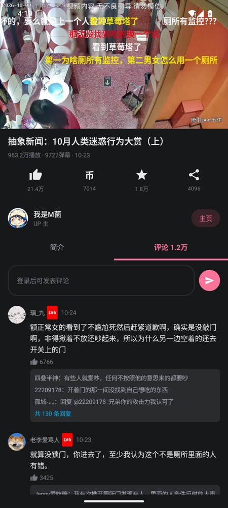
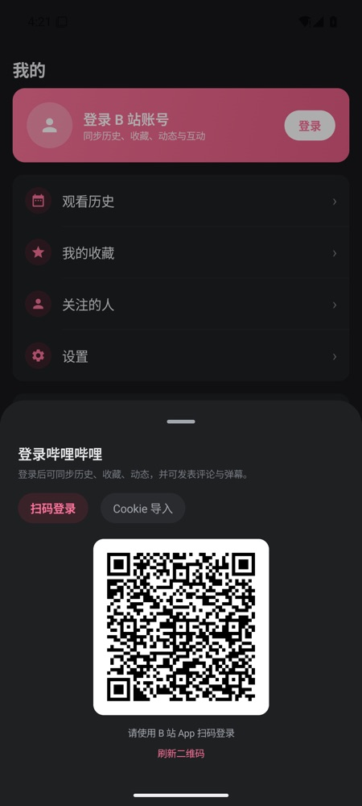
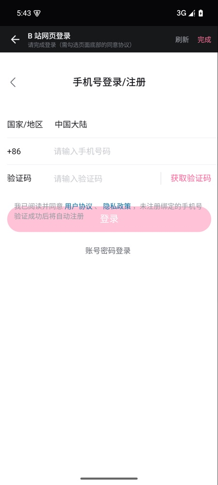
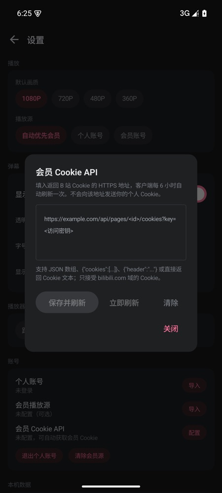

# 哔哩轻看 Android（BiliNative Android）


哔哩轻看（[BiliNative](https://github.com/ji1360677347/BiliNative)）的 Android 重写版：用 **Kotlin + Jetpack Compose + Media3** 重新实现首页浏览、DASH 播放、弹幕、评论、搜索、动态与账号体系，界面按 B 站 App / 原 iOS 客户端的视觉规范自行绘制。

> 非官方第三方客户端，仅供学习与个人使用。视频、弹幕、评论等内容的版权归哔哩哔哩及原作者所有，请遵守 B 站用户协议，不要用于商业用途或大规模抓取。

## 下载

[Releases](https://github.com/ji1360677347/BiliNative-Android/releases/latest) 提供可直接安装的 APK。安装包使用仓库内 `keystore/bili-native.jks` 固定签名，后续版本可直接覆盖安装；该证书仅用于本项目个人分发，请勿用于其他应用或商店上架。

> v0.1.0 使用 CI 临时 debug 签名。若从 v0.1.0 升级提示「签名不一致」，先卸载旧版再安装。也可以自行构建：`./gradlew assembleDebug`。

## 登录

安装后**不需要填写任何 API 地址**：

- **官方网页登录**（推荐）：我的 → 登录 → 网页登录 → 打开官方登录页，支持手机号验证码或账号密码，登录成功后自动返回。
- **扫码登录**：用 B 站 App 扫描二维码并确认。
- **Cookie 导入**：电脑浏览器登录 bilibili.com，复制任意请求的 Cookie 请求头（需含 `SESSDATA`）。

游客也能浏览首页、搜索、看视频和弹幕；登录后才有 1080P、历史、收藏、动态、评论与弹幕发送。

### 会员播放源（可选）

- **手动 Cookie**：设置 → 会员播放源 → 导入，粘贴大会员账号的 Cookie。
- **Cookie API**：设置 → 会员 Cookie API，填入返回 Cookie 的 HTTPS 地址（例如 NAS 的 `/api/pages/<id>/cookies?key=...`），取流前每 6 小时自动刷新一次。
- 支持 `JSON 数组`、`{"cookies":[...]}`、`{"header":"SESSDATA=..."}` 或直接返回 Cookie 文本；只接受 `bilibili.com` 域的 Cookie。
- 刷新失败不会覆盖已有会员 Cookie；手动粘贴 Cookie 会停止 API 自动更新。

| 首页 | 播放与弹幕 |
| --- | --- |
|  |  |
| **评论 / 楼中楼** | **扫码登录** |
|  |  |
| **官方网页登录（推荐）** | **会员 Cookie API** |
|  |  |

截图取自 Android 15（API 35）模拟器实测，界面同时支持深色与浅色主题。

## 功能

### 浏览
- 首页 **推荐 / 热门 / 排行榜**，双列封面卡片、下拉刷新、分页加载
- 搜索：综合 / 最多播放 / 最新发布 / 最多弹幕，本地搜索历史与 B 站热搜
- 关注动态流：文字、图片、投稿卡片，分页加载
- 收藏夹、关注列表、UP 主投稿、云端观看历史

### 播放
- DASH 视频 + 音频分流自动合流（`MergingMediaSource`），AVC / HEVC，硬件解码优先
- 画质切换（8K / 4K / 1080P60 / 1080P / 720P / 480P / 360P，按账号实际权限展示）
- 倍速（0.5x–3x）、拖动进度、双击暂停、横屏全屏
- 多分 P 选集、相关推荐、UP 主信息
- 会员播放源：可选「自动优先会员 / 个人账号 / 会员账号」，支持手动 Cookie 与 Cookie API 定时刷新，自动模式失败回退并提示
- 播放进度写入本机观看记录

### 弹幕
- 按 6 分钟分段拉取官方 protobuf 弹幕（`seg.so`），本地手写 proto 解码
- 滚动 / 顶部 / 底部弹幕，轨道自动避让
- 以播放器进度计算位置，暂停、拖动、倍速自然同步
- 开关、透明度、字号、显示区域可调

### 互动
- 评论列表、楼中楼预览与展开、评论点赞、发表评论
- 视频点赞 / 投币 / 收藏（收藏夹选择）/ 系统分享
- 发送弹幕（滚动 / 顶部 / 底部）

### 账号
- 三种登录方式：**官方网页登录**（账号密码 / 短信验证码）、扫码登录（二维码本地生成 + 轮询确认）、Cookie 导入
- 扫码回调同时解析回调 URL 与 `Set-Cookie`，避免部分账号拿不到 SESSDATA
- Cookie 导入支持仅 SESSDATA 的只读登录（评论/弹幕会提示需要完整 Cookie）
- 个人账号 / 会员源分开保存
- Cookie 仅保存在应用私有 `SharedPreferences`，不会上传到任何第三方
- 深色 / 浅色 / 跟随系统主题

## 尚未实现

直播、番剧独立入口（可通过 `ep` 链接或 BV 号解析）、字幕、投屏 / 画中画、离线缓存、NAS 媒体库。这些在 iOS 版本中已具备，Android 版会按优先级逐步补齐。

UP 主投稿列表（`/x/space/wbi/arc/search`）目前会被 B 站风控拦截（-352），页面会给出提示并提供浏览器打开入口；关注动态、收藏、历史等需要登录的接口已接线，但尚未用真实账号做端到端回归。

## 已验证范围

在 Android 15（API 35，arm64）模拟器上实际运行确认：

- 首页推荐 / 热门 / 排行榜、封面加载、下拉刷新与分页
- 视频详情、WBI `playurl` 取流、DASH 视频 + 音频合流播放、暂停 / 拖动 / 倍速
- 弹幕分段拉取、protobuf 解码、滚动与顶部 / 底部弹幕、暂停与拖动同步
- 评论列表、楼中楼预览、评论附图、点赞入口
- 搜索、排序、搜索历史、B 站热搜
- 本机观看记录写入与回放
- 扫码登录二维码生成与状态轮询；官方网页登录页（账号密码 / 短信）在 WebView 中正常加载
- 登录 Cookie 捕获与校验链路（未使用真实账号完成最终确认）
- 深色 / 浅色主题、横屏全屏播放与退出

登录后的云端历史、收藏夹、关注动态、评论 / 弹幕发送依赖真实账号，代码路径已完成但未在本次验证中执行写操作。

## 技术栈

| 模块 | 选型 |
| --- | --- |
| 语言 / UI | Kotlin 2.0、Jetpack Compose（Material 3） |
| 播放器 | AndroidX Media3 / ExoPlayer 1.4 |
| 网络 | OkHttp 4、自研 B 站 Web API 封装 |
| 图片 | Coil 2（共享 OkHttp、统一 Referer / UA） |
| 二维码 | ZXing core |
| 构建 | AGP 8.7、Gradle 8.9、JDK 17+、compileSdk 35、minSdk 26 |

`core` 层逻辑从 iOS 版 `Sources/BiliCore` 移植：

- WBI 签名（`w_rid` / `wts`，mixin 表 + MD5）
- DASH `playurl` 解析与播放源选择
- 弹幕 protobuf 手写解码（`DmSegMobileReply`）
- 评论 / 动态 / 历史 / 收藏 JSON 宽松解析
- 设备 Cookie（`buvid3` / `buvid4`）自动获取，提升游客访问成功率

## 构建

```bash
# 需要 JDK 17+ 与 Android SDK Platform 35、Build-Tools 35.0.0
echo "sdk.dir=$HOME/Library/Android/sdk" > local.properties
./gradlew assembleDebug
```

产物：`app/build/outputs/apk/debug/app-debug.apk`

Release 包默认使用 debug 签名，方便直接安装；正式分发请自行配置签名。

## 项目结构

```
app/src/main/java/local/bili23/android/
├── BiliApp.kt              # Application、Coil 配置、全局依赖
├── MainActivity.kt         # 入口、深链（BV 号）
├── AppRuntime.kt           # 主题等跨页状态
├── core/
│   ├── BiliClient.kt       # 全部 B 站接口
│   ├── Http.kt             # OkHttp 封装（UA / Referer / 表单）
│   ├── Wbi.kt              # WBI 签名
│   ├── DanmakuParser.kt    # 弹幕 protobuf 解码
│   ├── Models.kt           # 数据模型与解析
│   └── Store.kt            # Cookie / 设置 / 本机记录
└── ui/
    ├── RootNav.kt          # 导航与底部栏
    ├── home/               # 首页三栏
    ├── player/             # 播放页、弹幕层、评论
    ├── search/             # 搜索与热搜
    ├── dynamic/            # 动态流
    ├── profile/            # 我的、登录、历史、收藏、关注、设置
    ├── common/             # 封面卡片、等级徽章、通用状态
    └── theme/              # B 站配色与排版
```

## 与 iOS 版的关系

本项目是 [BiliNative](https://github.com/ji1360677347/BiliNative) 的独立 Android 实现，共享相同的接口约定与交互设计，但不复用 Swift 代码或官方二进制。iOS 版仍以 SwiftUI 持续维护。

## 开发笔记

移植过程中的关键坑（64 位 cid、412 风控、WBI、DASH 合流、弹幕轨道）记录在 [docs/DEVNOTES.md](docs/DEVNOTES.md)。

## 免责声明

- 项目未使用 B 站官方开放平台以外的私有接口，接口可能随官方调整而失效。
- 不提供任何破解、去广告、绕过付费墙的能力；会员画质依赖账号自身权益。
- 请勿将本项目用于任何违反 B 站用户协议或法律法规的用途。
